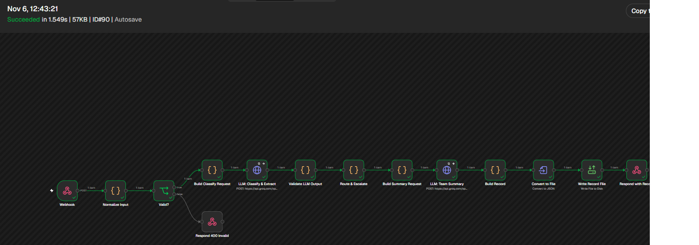

# ArcVault AI Intake & Triage

An n8n workflow that takes unstructured customer requests for **ArcVault**, a fictional B2B SaaS company. For each
request it:
1. classifies and enriches it with an LLM
2. routes it to the right team queue with deterministic rules
3. flags risky cases for human review
4. writes a structured JSON record with a hand-off summary for the receiving team

Everything runs on free tooling:
- **n8n 2.46.6**, self-hosted in Docker
- **Groq**: `openai/gpt-oss-120b` for classification, `openai/gpt-oss-20b` for the summary

```
Webhook → Normalize & validate → LLM: classify + extract → Validate & ground output
        → Route & escalate (code) → LLM: team summary → Build record → Write file → Respond
```

| Document | Contents |
|---|---|
| [docs/ARCHITECTURE.md](docs/ARCHITECTURE.md) | System design, routing and escalation logic, production scale, Phase 2 |
| [docs/PROMPTS.md](docs/PROMPTS.md) | Both prompts verbatim, why they are structured that way, iteration history |
| [output/arcvault_output.json](output/arcvault_output.json) | Output records for all sample inputs |
| [workflow/arcvault-triage.json](workflow/arcvault-triage.json) | The exported n8n workflow |

## Results

The 5 brief samples plus 3 edge cases ([samples/requests.json](samples/requests.json)) all match their expected
results, and are identical across repeated runs.

| # | Input | Category | Priority | Destination | Escalation reason |
|---|---|---|---|---|---|
| 1 | 403 on login after update | Bug Report | High | Engineering | |
| 2 | Bulk export for audit logs | Feature Request | Low | Product | |
| 3 | Invoice $1,240 vs $980 contract | Billing Issue | Medium | Billing | ($260 gap is under $500) |
| 4 | SSO with Okta? | Technical Question | Low | Technical Support | |
| 5 | Dashboard down, multiple users | Incident/Outage | High | Escalation – Human Review | Outage; "multiple users" |
| 6 | *Edge:* vague mixed message | Bug Report | Medium | Escalation – Human Review | Confidence 0.65 < 0.70 |
| 7 | *Edge:* $4,750 vs $2,900 contract | Billing Issue | High | Escalation – Human Review | $1,850 gap > $500 |
| 8 | *Edge:* prompt injection + 502 outage | Incident/Outage | High | Escalation – Human Review | Outage; injection attempt |

A holdout set of 3 unseen messages ([samples/holdout.json](samples/holdout.json)), written before prompt tuning,
scored 2/3. The miss is explained in [ARCHITECTURE.md](docs/ARCHITECTURE.md#3-escalation-logic).

<details>
<summary>Example output record (sample 7, abridged)</summary>

```json
{
  "source": "Support Portal",
  "raw_message": "Invoice #9104 billed us $4,750 but our signed contract is $2,900/month. This is the second month in a row and finance is holding payment until it's corrected.",
  "category": "Billing Issue",
  "priority": "High",
  "confidence": 0.95,
  "core_issue": "The invoice amount billed does not match the contract rate.",
  "identifiers": { "invoice_numbers": ["9104"] },
  "amounts": { "billed": 4750, "expected": 2900, "currency": "USD", "difference": 1850 },
  "urgency": { "level": "High", "signals": ["finance is holding payment"] },
  "suggested_queue": "Billing",
  "destination_queue": "Escalation – Human Review",
  "escalated": true,
  "escalation_reasons": ["Billing discrepancy of $1,850 exceeds $500 (billed $4,750 vs expected $2,900)"],
  "summary": "Invoice #9104 billed $4,750 instead of the contracted $2,900, causing finance to hold payment. The discrepancy of $1,850 exceeds the $500 threshold, requiring human review; the reviewer should confirm the billing error and forward the case to the Billing team for resolution."
}
```

Each full record also includes `request_id`, timestamps, `secondary_category`, `category_rationale`, all identifier
types, `impact_scope`, validation `checks` (grounding warnings, injection flag, summary source), the model and prompt
version for each LLM call, and token usage.

</details>

## Screenshots

One execution of sample 7 (an invoice $1,850 above the contract rate), step by step:

| Step | Screenshot |
|---|---|
| The workflow (all nodes succeeded) | [01-workflow-overview.png](screenshots/01-workflow-overview.png) |
| LLM call 1: raw classification, reasoning and token usage | [02-llm-classify-output.png](screenshots/02-llm-classify-output.png) |
| Validated and grounded classification | [03-validate-output.png](screenshots/03-validate-output.png) |
| Routing and escalation decision with its reason | [04-route-escalate.png](screenshots/04-route-escalate.png) |
| LLM call 2: team summary | [05-team-summary.png](screenshots/05-team-summary.png) |
| Final record | [06-build-record.png](screenshots/06-build-record.png) |



## Run it

**Prerequisites:** Docker, and a free Groq API key from [console.groq.com](https://console.groq.com).

```bash
git clone https://github.com/MohamadHazime/arcvault-triage.git
cd arcvault-triage
docker compose up -d                       # n8n at http://localhost:5678
```

Then, in the n8n editor at http://localhost:5678:

1. **Create the owner account.** It exists only in your local instance.
2. **Add the Groq credential:** *Create → Credential → Header Auth*.
   - **Name:** `Authorization`
   - **Value:** `Bearer <your Groq key>`
   - **Save it as** `Groq API`
3. **Import the workflow:** create a workflow, then use the **⋯ menu → Import from File** and choose
   `workflow/arcvault-triage.json`.
4. **Select the credential:** open the two **LLM** nodes and select your `Groq API` credential in each. Credentials are
   never exported.
5. **Save and Publish** the workflow, so the production webhook goes live.

Send the samples (Windows PowerShell 5.1+, or PowerShell 7 on macOS/Linux):

```powershell
powershell -File scripts/send-samples.ps1                 # all 8, prints PASS/FAIL, writes output/arcvault_output.json
powershell -File scripts/send-samples.ps1 -Ids 3,7        # a subset
```

Or send a single message from any shell:

```bash
curl -X POST http://localhost:5678/webhook/arcvault-intake \
  -H "Content-Type: application/json" \
  -d '{"source":"Email","message":"Invoice #7001 charged us $3,200 but our plan is $1,200 per month."}'
```

The script pauses 20 s between requests (`-DelaySeconds`), because the Groq free tier allows about 8K tokens per
minute. Each record is also written to `output/records/<request_id>.json`.

## Repository layout

| Path | Contents |
|---|---|
| `workflow/` | Exported n8n workflow (importable JSON; contains the Code-node logic and prompts) |
| `samples/` | Sample requests with expected results, plus the holdout set |
| `scripts/` | Sender script that replays samples against the webhook and checks expected results |
| `output/` | `arcvault_output.json` (final results); `records/` holds per-request files (git-ignored) |
| `docs/` | Architecture write-up and prompt documentation |
| `screenshots/` | Workflow and node-output screenshots |
| `docker-compose.yml` | n8n 2.46.6, pinned, with file access restricted to `/files` |
